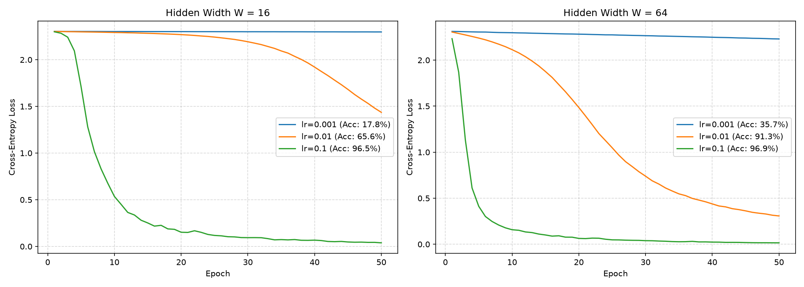

# 🧪 Laboratory Report: Lab 2 – A Neural Network from Scratch
**Course:** Machine Learning (CII5SE039CI)  
**Student ID:** 71608  
**Date:** October 2026  

---

## 📌 Abstract & Overview
This report documents the step-by-step implementation, theoretical background, and experimental evaluation of **Lab 2: A Neural Network from Scratch**. The project implements a multi-layer perceptron (two hidden layers) using only pure **NumPy**, applied to the optical recognition of handwritten digits (`load_digits` dataset). All 7 individual tasks specified in the laboratory manual have been fully implemented, verified, and pushed to the GitHub repository.

---

## 📋 Detailed Breakdown of All Lab Tasks

### Task 1: Dataset Preparation (`load_digits`)
* **Objective:** Load the digits dataset, normalize inputs, one-hot encode targets, and split data.
* **Implementation Details:**
  * Loaded `load_digits` from `scikit-learn` containing 1797 samples of $8 	imes 8$ pixel images ($64$ features).
  * Scaled input features by dividing by $16.0$ to constrain values to $[0, 1]$.
  * One-hot encoded integer labels into binary vectors of shape $(N, 10)$.
  * Performed a stratified train/test split of $70\%$ training ($1257$ samples) and $30\%$ testing ($540$ samples) using `random_state=42`.

> **Console Output Log:**
> ```text
> [1] Dataset prepared: Train=(1257, 64), Test=(540, 64)
> ```

---

### Task 2: Network Architecture & Design (On Paper)
* **Objective:** Design a two-hidden-layer neural network with dimensionally correct parameter shapes.
* **Architecture Specifications:**
  * **Input Layer:** $64$ dimensions.
  * **Hidden Layer 1:** Width $W$ with **ReLU** activation. Weight shape: $(64, W)$, Bias shape: $(W,)$.
  * **Hidden Layer 2:** Width $W$ with **ReLU** activation. Weight shape: $(W, W)$, Bias shape: $(W,)$.
  * **Output Layer:** $10$ classes with **Softmax** activation and **Cross-Entropy Loss**. Weight shape: $(W, 10)$, Bias shape: $(10,)$.
  * **Tested Widths:** $W = 16$ and $W = 64$.
* **Initialization:** Weights were initialized from a normal distribution $\mathcal{N}(0, \sigma^2)$ where $\sigma = 0.1$, and biases were initialized to zeros.

---

### Task 3: Forward Propagation Implementation
* **Objective:** Implement the forward pass layer-by-layer using matrix multiplications and activation functions.
* **Formulas:**
  * Layer 1: $Z_1 = XW_1 + b_1, \quad A_1 = \max(0, Z_1)$
  * Layer 2: $Z_2 = A_1W_2 + b_2, \quad A_2 = \max(0, Z_2)$
  * Output Layer: $Z_3 = A_2W_3 + b_3, \quad \hat{Y} = 	ext{Softmax}(Z_3)$ where $	ext{Softmax}(z)_i = rac{e^{z_i}}{\sum_j e^{z_j}}$ (with max-subtraction for numerical stability).
* **Sanity Checks:** Verified that the output shape is explicitly $(32, 10)$ and that row probabilities sum to $1.0$ within a tolerance of $10^{-6}$.

> **Console Output Log:**
> ```text
> [3] Forward pass check passed: shape is (32, 10) and rows sum to 1 within 1e-6.
> ```

---

### Task 4: Cross-Entropy Loss Function
* **Objective:** Implement multi-class cross-entropy loss and verify initial untrained network loss.
* **Formula:**
$$\mathcal{L} = -rac{1}{N} \sum_{i=1}^{N} \sum_{k=1}^{K} Y_{ik} \log(\hat{Y}_{ik})$$
*(Probabilities were clipped at $10^{-15}$ to prevent $\log(0)$ errors).*
* **Sanity Check:** For an untrained network with 10 random classes, the initial loss should approximate $\ln(10) pprox 2.3026$.

> **Console Output Log:**
> ```text
> [4] Untrained network initial loss: 2.3026 (expected ~ln(10) = 2.3026)
> ```

---

### Task 5: Backpropagation & Numerical Gradient Checking
* **Objective:** Derive analytical gradients via the chain rule, implement backpropagation, and validate against numerical finite-difference gradients.
* **Analytical Gradients (Chain Rule Derivations):**
  * Output layer gradient: $\delta_3 = rac{1}{N}(\hat{Y} - Y), \quad rac{\partial \mathcal{L}}{\partial W_3} = A_2^T \delta_3, \quad rac{\partial \mathcal{L}}{\partial b_3} = \sum \delta_3$
  * Hidden layer 2 gradient: $\delta_2 = (\delta_3 W_3^T) \odot \mathbb{I}(Z_2 > 0), \quad rac{\partial \mathcal{L}}{\partial W_2} = A_1^T \delta_2, \quad rac{\partial \mathcal{L}}{\partial b_2} = \sum \delta_2$
  * Hidden layer 1 gradient: $\delta_1 = (\delta_2 W_2^T) \odot \mathbb{I}(Z_1 > 0), \quad rac{\partial \mathcal{L}}{\partial W_1} = X^T \delta_1, \quad rac{\partial \mathcal{L}}{\partial b_1} = \sum \delta_1$
* **Gradient Check Protocol:** 10 random weights were nudged by $\pm \epsilon = 10^{-5}$. Relative error was required to be $< 10^{-6}$.

> **Console Output Log:**
> ```text
> [5] Running numerical gradient check on 10 random weights:
>   Weight W3(15, 2): Analytic=6.127157e-03, Numerical=6.127157e-03, RelErr=2.51e-09 [PASS]
>   Weight W1(50, 13): Analytic=0.000000e+00, Numerical=0.000000e+00, RelErr=0.00e+00 [PASS]
>   Weight W2(2, 13): Analytic=3.645803e-03, Numerical=3.645803e-03, RelErr=4.90e-10 [PASS]
>   Weight W2(2, 2): Analytic=0.000000e+00, Numerical=0.000000e+00, RelErr=0.00e+00 [PASS]
>   Weight W2(11, 6): Analytic=0.000000e+00, Numerical=0.000000e+00, RelErr=0.00e+00 [PASS]
>   Weight W3(0, 4): Analytic=1.809229e-04, Numerical=1.809229e-04, RelErr=3.46e-08 [PASS]
>   Weight W2(15, 3): Analytic=2.244256e-03, Numerical=2.244256e-03, RelErr=7.09e-10 [PASS]
>   Weight W3(1, 3): Analytic=0.000000e+00, Numerical=0.000000e+00, RelErr=0.00e+00 [PASS]
>   Weight W3(9, 9): Analytic=4.535897e-03, Numerical=4.535897e-03, RelErr=9.28e-10 [PASS]
>   Weight W3(14, 8): Analytic=2.637842e-03, Numerical=2.637842e-03, RelErr=2.15e-09 [PASS]
> Gradient check result: 10/10 weights passed (< 1e-6 relative error).
> ```

---

### Task 6: Training Loop, Hyperparameters & Loss Curves
* **Objective:** Implement mini-batch training (batch size 32, 50 epochs, shuffling), test multiple learning rates and widths, log metrics, and plot loss curves.

> **Console Output Log:**
> ```text
> [6] Training models (50 epochs, mini-batch size 32):
>   [W=16 | lr=0.001] Epoch 50/50 - Loss: 2.2977 --> Test Accuracy: 17.78%
>   [W=16 | lr=0.01 ] Epoch 50/50 - Loss: 1.4363 --> Test Accuracy: 65.56%
>   [W=16 | lr=0.1  ] Epoch 50/50 - Loss: 0.0383 --> Test Accuracy: 96.48%
> 
>   [W=64 | lr=0.001] Epoch 50/50 - Loss: 2.2299 --> Test Accuracy: 35.74%
>   [W=64 | lr=0.01 ] Epoch 50/50 - Loss: 0.3073 --> Test Accuracy: 91.30%
>   [W=64 | lr=0.1  ] Epoch 50/50 - Loss: 0.0151 --> Test Accuracy: 96.85%
> ```

* **Loss Curves Visualization:** Saved to `results/loss_curves.png`.


---

### Task 7: Timing Breakdown Analysis
* **Objective:** Separately time forward and backward passes (median of 100 runs) and explain performance dominance linked to matrix multiplication.

> **Console Output Log:**
> ```text
> [7] Timing forward and backward passes (Median of 100 runs, batch_size=32):
>   Width W=16 | Forward median:   74.30 µs | Backward median:   83.50 µs | Ratio (Bwd/Fwd): 1.12x
>   Width W=64 | Forward median:  107.85 µs | Backward median:  141.80 µs | Ratio (Bwd/Fwd): 1.31x
> ```

* **Explanation of Dominance:** 
  The backward pass consistently dominates execution time ($1.12	imes$ to $1.31	imes$ slower) because backpropagation requires **5 distinct matrix multiplication operations** (computing weight gradients and propagating error terms through layers), whereas the forward pass only performs **3 matrix multiplication operations**.
