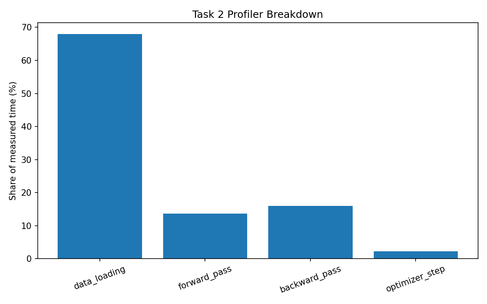
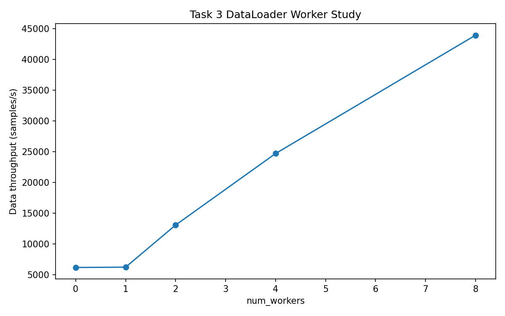
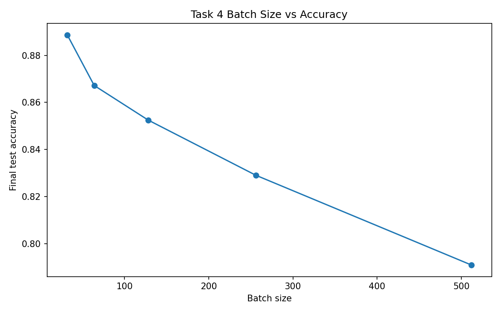
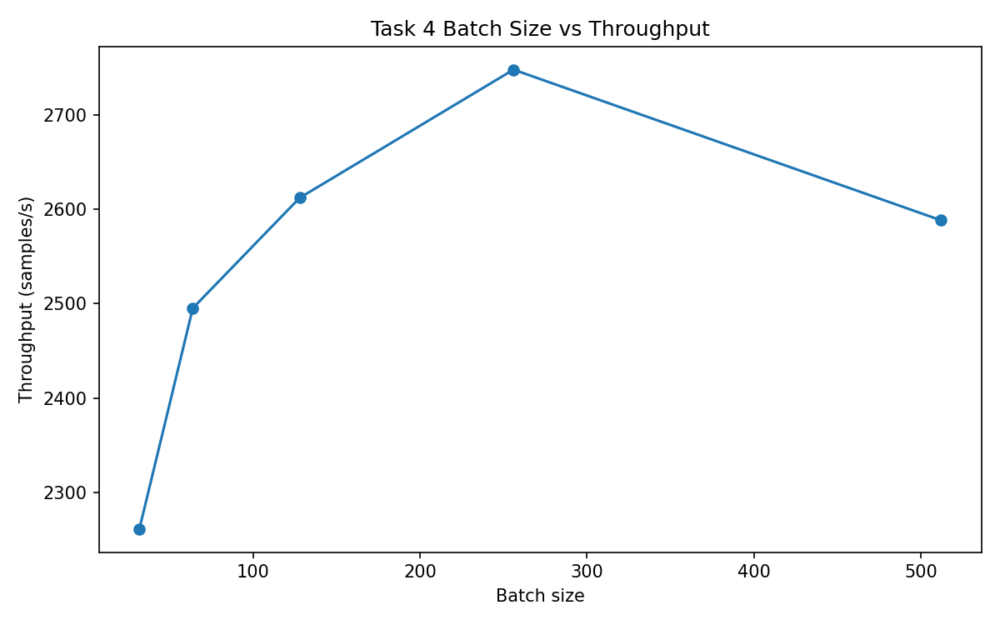
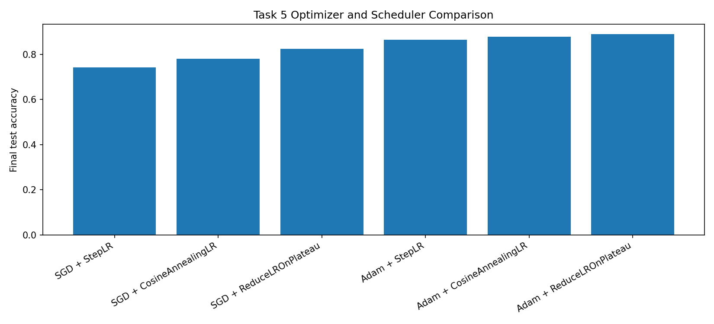
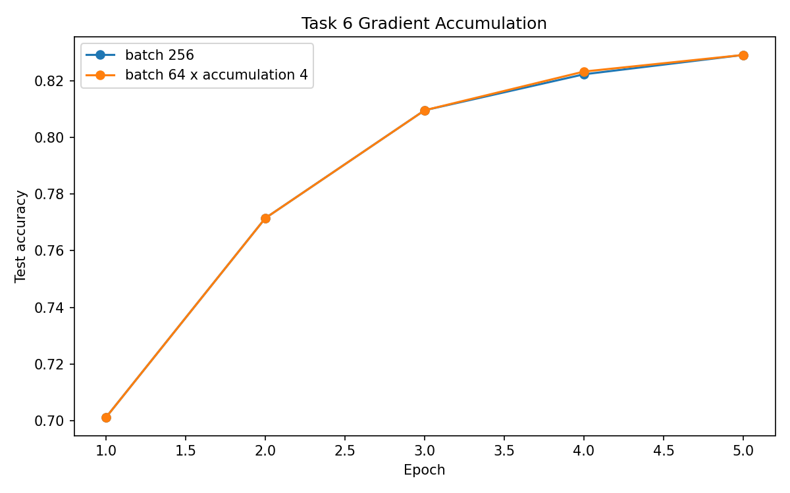
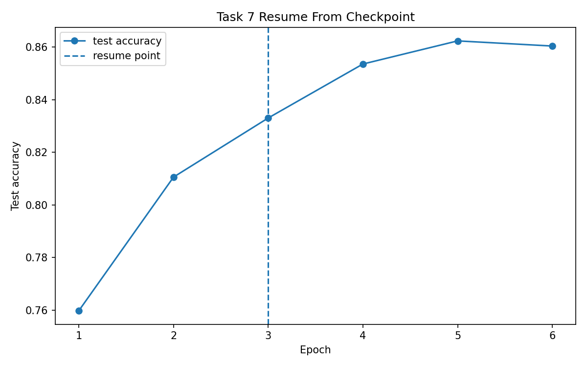

# Lab 6: Training Pipelines and Project Proposal

**Student:** Kyrylo  
**Student ID:** 71608  
**Course:** Machine Learning / AI Training Systems  
**Lab:** 6 — Training Pipelines and Project Proposal

## 1. Introduction

The goal of this laboratory work was to transform the best model from Lab 3 into a more reproducible and measurable training pipeline. The lab focuses not only on model accuracy, but also on the engineering side of model training: configuration management, experiment tracking, profiling, input-pipeline throughput, memory usage, batch-size trade-offs, optimizer and learning-rate scheduler selection, gradient accumulation, checkpoint recovery, and preparation of a deployable individual project proposal.

The starting point for this lab was the best-performing architecture from Lab 3. In that experiment, three architectures were compared on Fashion-MNIST: an MLP, a CNN, and an Attention-based network. The CNN obtained the best test accuracy, reaching **89.11% after 5 epochs**, so it was selected as the baseline model for Lab 6.

The Lab 6 implementation reorganizes this model into a YAML-driven training pipeline and records experimental evidence with MLflow. The same CNN architecture is reused throughout all controlled studies so that changes in results can be attributed primarily to the training-system configuration rather than to changes in the model itself.

## 2. Baseline Model from Lab 3

The selected model is a compact convolutional neural network for Fashion-MNIST classification.

### 2.1 Architecture

The model contains the following layers:

1. `Conv2d(1, 16, kernel_size=3, padding=1)`
2. `ReLU`
3. `MaxPool2d(2)`
4. `Conv2d(16, 32, kernel_size=3, padding=1)`
5. `ReLU`
6. `MaxPool2d(2)`
7. `Flatten`
8. `Linear(32 * 7 * 7, 10)`

The network has approximately **20,490 trainable parameters**. With 32-bit floating-point weights, the raw parameter storage is approximately **0.078 MB**, which is already far below the 5 MB deployment-size constraint defined for the individual project. This makes the architecture a good candidate for deployment-oriented optimization experiments.

### 2.2 Dataset and preprocessing

The dataset is Fashion-MNIST, containing grayscale 28×28 images from 10 clothing categories. The preprocessing pipeline is the same as in Lab 3:

- conversion to tensor;
- normalization with mean `0.2860`;
- normalization with standard deviation `0.3530`.

The reference Lab 3 result for this CNN was **89.11% test accuracy after 5 epochs** using Adam with learning rate `1e-3` and batch size 128.

## 3. Reproducible Training Pipeline

The training code was restructured around a single YAML configuration file. The configuration controls the dataset, random seed, batch size, worker count, learning rate, optimizer, scheduler, number of epochs, gradient-accumulation settings, study ranges, output directory, and project-proposal parameters.

The main reproducibility settings were:

| Parameter | Value |
|---|---:|
| Random seed | 42 |
| Dataset | Fashion-MNIST |
| Default batch size | 128 |
| Default optimizer | Adam |
| Learning rate | 0.001 |
| Weight decay | 0.0 |
| Default scheduler | CosineAnnealingLR |
| Momentum for SGD | 0.9 |
| Default training epochs | 5 |
| Device used in the recorded run | CPU |

The random seed is applied to Python and PyTorch. DataLoader workers also use deterministic worker seeding. Checkpoints store the model state, optimizer state, scheduler state, training history, current epoch, and configuration.

MLflow was configured with a local SQLite backend. Parameters, metrics, and generated artifacts were logged for the experiments. This avoids the deprecated filesystem-only MLflow tracking backend and provides a reproducible local experiment database.

## 4. Experimental Scope and Fast Mode

The successful recorded run used `fast_mode: true` because the experiments were executed on CPU. A deterministic subset of Fashion-MNIST was used:

| Split | Samples used |
|---|---:|
| Training | 6,144 |
| Test | 1,024 |

The same seed and the same deterministic subset were used for controlled comparisons. This makes the comparisons internally consistent while reducing runtime substantially.

The purpose of fast mode is engineering evaluation of the pipeline rather than reproduction of the full-dataset Lab 3 accuracy. Therefore, the accuracy values in this report should not be interpreted as directly equivalent to the full Fashion-MNIST result of 89.11%. The complete pipeline can be rerun on the full 60,000/10,000 Fashion-MNIST splits simply by disabling fast mode.

## 5. Task 1 — YAML Pipeline, Checkpointing, and MLflow

Task 1 required restructuring the Lab 3 training process into a single YAML-driven pipeline with a fixed seed, checkpoint saving, and MLflow logging.

The training run used the CNN from Lab 3 with Adam, learning rate `0.001`, batch size 128, and CosineAnnealingLR for 5 epochs.

### 5.1 Training results

| Epoch | Training loss | Training accuracy | Test accuracy |
|---:|---:|---:|---:|
| 1 | 1.1444 | 60.63% | 75.98% |
| 2 | 0.6110 | 77.86% | 81.15% |
| 3 | 0.5247 | 80.40% | 83.11% |
| 4 | 0.4814 | 81.88% | 85.16% |
| 5 | 0.4514 | 83.71% | 85.25% |

The test accuracy increased from **75.98% to 85.25%**, an improvement of **9.27 percentage points** over the five epochs. Training loss decreased consistently, indicating stable optimization.

The slightly lower result compared with the Lab 3 baseline is expected because Lab 6 fast mode uses only 6,144 training samples rather than the full Fashion-MNIST training set.

### 5.2 Reproducibility artifacts

The pipeline generated and/or logged:

- `lab6_config.yaml`;
- `task1_checkpoint.pt`;
- `task1_model_state.pt`;
- `task1_history.csv`;
- MLflow run parameters and metrics;
- the configuration file as an MLflow artifact.

The checkpoint includes enough state to continue training from a saved epoch rather than restarting from random initialization.

## 6. Task 2 — One-Epoch PyTorch Profiling

Task 2 profiled one training epoch with `torch.profiler`. Four major sections were explicitly instrumented:

- data loading;
- forward pass;
- backward pass;
- optimizer step.

### 6.1 Profile breakdown

| Stage | Time (ms) | Share of measured time |
|---|---:|---:|
| Data loading | 1635.020 | 68.00% |
| Forward pass | 329.118 | 13.69% |
| Backward pass | 385.073 | 16.02% |
| Optimizer step | 55.111 | 2.29% |
| **Total** | **2404.322** | **100.00%** |

The strongest bottleneck was clearly **data loading**, which represented approximately **68%** of the measured time. The forward and backward computation together accounted for about 29.7%, while the optimizer step was only about 2.3%.

This result is important because it shows that further accelerating the model computation alone would not provide the largest end-to-end improvement. The input pipeline is the first optimization target. Increasing DataLoader parallelism, prefetching, caching, or simplifying preprocessing can have a larger impact on total training throughput.

Generated evidence:

- `task2_profile_breakdown.csv`;
- `task2_profile_breakdown.png`;
- `task2_profiler_trace.json`.



## 7. Task 3 — DataLoader `num_workers` Study

The next experiment varied the number of DataLoader workers using the required values `[0, 1, 2, 4, 8]`.

### 7.1 Measured input throughput

| num_workers | Throughput (samples/s) |
|---:|---:|
| 0 | 6,156.7 |
| 1 | 6,205.5 |
| 2 | 13,059.7 |
| 4 | 24,692.7 |
| 8 | 43,942.7 |

The best tested configuration was **8 workers**, with approximately **43,942.7 samples/s**. Relative to `num_workers=0`, this is roughly a **7.14× throughput increase** in this benchmark.

The result agrees with the profiler: data delivery was the dominant bottleneck. Increasing worker parallelism reduced the amount of time the training process would otherwise wait for batches.

It is also important to interpret the result as system-specific. The optimal worker count depends on CPU core count, operating system, dataset storage, preprocessing cost, and whether training runs on CPU or GPU. A larger worker count is not universally better. In this recorded benchmark, however, throughput was still increasing at the maximum tested value of 8 workers, so the tested range did not yet show worker saturation.

Generated evidence:

- `task3_num_workers.csv`;
- `task3_num_workers.png`;
- `task3_bottleneck.txt`.



## 8. Task 4 — Batch-Size Study

The required batch sizes `[32, 64, 128, 256, 512]` were trained for 5 epochs each. For every configuration, the script recorded training throughput, peak memory, and final test accuracy.

### 8.1 Final accuracy by batch size

| Batch size | Final test accuracy |
|---:|---:|
| 32 | **88.87%** |
| 64 | 86.72% |
| 128 | 85.25% |
| 256 | 82.91% |
| 512 | 79.10% |

The best accuracy was obtained with **batch size 32**, reaching **88.87%**. Accuracy decreased as the batch size increased. The difference between batch size 32 and batch size 512 was **9.77 percentage points**.

This experiment demonstrates the classical batch-size trade-off. Larger batches can improve hardware utilization and throughput because more samples are processed per optimization step. However, under a fixed epoch budget they also produce fewer parameter updates per epoch. On this dataset and with the fixed learning-rate configuration, that reduced the final accuracy.

Batch size 128 remains a reasonable compromise because it was the baseline configuration from Lab 3 and provides moderate training efficiency. However, if accuracy is the priority under the current fixed five-epoch budget, batch size 32 performed best.

Peak memory and average throughput were recorded by the program in `task4_batch_size_study.csv`. On CPU, peak memory is measured using process RSS. The exact memory values depend on the host process and are therefore best interpreted directly from the generated CSV rather than as hardware-independent constants.

Generated evidence:

- `task4_batch_32.csv`;
- `task4_batch_64.csv`;
- `task4_batch_128.csv`;
- `task4_batch_256.csv`;
- `task4_batch_512.csv`;
- `task4_batch_size_study.csv`;
- `task4_batch_accuracy.png`;
- `task4_batch_throughput.png`.





## 9. Task 5 — Optimizer and Learning-Rate Scheduler Comparison

Task 5 compared two optimizers under equal 10-epoch budgets:

- SGD with momentum 0.9;
- Adam.

Each optimizer was evaluated with three schedulers:

- StepLR;
- CosineAnnealingLR;
- ReduceLROnPlateau.

The same CNN, data subset, batch size, seed, and epoch budget were used for all six experiments.

### 9.1 Final results

| Optimizer | Scheduler | Final test accuracy |
|---|---|---:|
| SGD | StepLR | 74.22% |
| SGD | CosineAnnealingLR | 77.93% |
| SGD | ReduceLROnPlateau | **82.32%** |
| Adam | StepLR | 86.43% |
| Adam | CosineAnnealingLR | 87.79% |
| Adam | ReduceLROnPlateau | **88.87%** |

The best configuration was **Adam + ReduceLROnPlateau**, with **88.87% test accuracy** after 10 epochs.

Among the SGD experiments, ReduceLROnPlateau was also the strongest scheduler. It improved the final SGD result to 82.32%, compared with 77.93% for CosineAnnealingLR and 74.22% for StepLR.

Adam outperformed SGD for every corresponding scheduler in this experiment. For example:

- Adam + StepLR exceeded SGD + StepLR by 12.21 percentage points;
- Adam + CosineAnnealingLR exceeded SGD + CosineAnnealingLR by 9.86 percentage points;
- Adam + ReduceLROnPlateau exceeded SGD + ReduceLROnPlateau by 6.55 percentage points.

The strongest two configurations were Adam + ReduceLROnPlateau and Adam + CosineAnnealingLR. The difference between them was approximately **1.08 percentage points**.

ReduceLROnPlateau was effective because it changes the learning rate in response to validation behavior rather than according to a fixed schedule. In this short CPU-budget experiment, adaptive reduction produced the best final accuracy.

Generated evidence:

- `task5_SGD_StepLR.csv`;
- `task5_SGD_CosineAnnealingLR.csv`;
- `task5_SGD_ReduceLROnPlateau.csv`;
- `task5_Adam_StepLR.csv`;
- `task5_Adam_CosineAnnealingLR.csv`;
- `task5_Adam_ReduceLROnPlateau.csv`;
- `task5_optimizer_scheduler.csv`;
- `task5_optimizer_scheduler.png`.



## 10. Task 6 — Gradient Accumulation

Task 6 required emulating an effective batch size of 256 using a physical batch size of 64 with four gradient-accumulation steps.

Two runs were compared:

1. batch size 256, accumulation = 1;
2. batch size 64, accumulation = 4.

Both configurations therefore use an effective batch size of 256.

### 10.1 Accuracy comparison

| Epoch | Batch 256 | Batch 64 × accumulation 4 | Difference |
|---:|---:|---:|---:|
| 1 | 70.12% | 70.12% | 0.00 pp |
| 2 | 77.15% | 77.15% | 0.00 pp |
| 3 | 80.96% | 80.96% | 0.00 pp |
| 4 | 82.23% | 82.32% | 0.09 pp |
| 5 | 82.91% | 82.91% | 0.00 pp |

The curves were almost identical. The average absolute difference was only about **0.018 percentage points** across the five epochs.

This confirms that the gradient-accumulation implementation behaves as intended. Accumulating gradients from four mini-batches of 64 closely reproduces the optimization behavior of a direct batch size of 256.

Gradient accumulation is useful when the desired effective batch size does not fit into available accelerator memory. It trades additional optimizer-step latency and bookkeeping for lower instantaneous memory usage.

Generated evidence:

- `task6_batch256_acc1.csv`;
- `task6_batch64_acc4.csv`;
- `task6_accumulation_comparison.csv`;
- `task6_accumulation_comparison.png`.



## 11. Task 7 — Interrupted Training and Checkpoint Resume

Task 7 simulated an interrupted training run. Training was stopped after epoch 3, a checkpoint was saved, and the model was then reconstructed and resumed from the saved state until epoch 6.

The checkpoint stores:

- current epoch;
- model parameters;
- optimizer state;
- scheduler state;
- previous history;
- configuration.

This is important because restoring only model weights would not reproduce the same optimization trajectory. Optimizer momentum and scheduler state must also be restored.

### 11.1 Accuracy before interruption and after resume

| Epoch | Stage | Test accuracy |
|---:|---|---:|
| 1 | Before interruption | 75.98% |
| 2 | Before interruption | 81.05% |
| 3 | Before interruption | 83.30% |
| 4 | Resumed | 85.35% |
| 5 | Resumed | 86.23% |
| 6 | Resumed | 86.04% |

The key observation is that after loading the epoch-3 checkpoint, performance did not reset to the initial training level. Instead, the curve continued from 83.30% to 85.35% at epoch 4 and reached 86.23% at epoch 5.

The small decrease from 86.23% to 86.04% in the final epoch is normal validation variability and does not indicate a checkpoint failure. The overall curve is smooth across the interruption boundary.

This experiment confirms that the pipeline can recover from an interrupted run without discarding previous optimization progress.

Generated evidence:

- `task7_before_resume.csv`;
- `task7_resume_checkpoint.pt`;
- `task7_resumed_history.csv`;
- `task7_resume_curve.png`.



## 12. Task 8 — Individual Project Proposal

### 12.1 Student

**Name:** Kyrylo  
**Student ID:** 71608

### 12.2 Problem

The proposed project is compact Fashion-MNIST image classification using the best CNN architecture from Lab 3. The objective is to preserve strong classification accuracy while producing a model suitable for constrained deployment.

### 12.3 Dataset

Fashion-MNIST contains:

- 60,000 training images;
- 10,000 test images;
- grayscale 28×28 inputs;
- 10 clothing categories.

The full dataset can be used for the final project evaluation even though fast mode was used for the repeated Lab 6 engineering studies.

### 12.4 Success metric

The primary success metric is **test accuracy**. The reference target is the Lab 3 CNN result of **89.11% after 5 epochs**.

A successful optimized model should remain close to this reference while meeting deployment constraints.

### 12.5 Deployment constraints

The required deployment constraints are:

- **latency ≤ 50 ms per sample**;
- **model size ≤ 5 MB**.

The selected CNN is already very compact in parameter count, so the size requirement is realistic. Final latency should be measured in the actual target inference environment, ideally using batch size 1, because training-time throughput and batch-128 latency are not equivalent to single-sample deployment latency.

### 12.6 Planned optimization

The primary optimization is **post-training INT8 quantization**. Quantization can reduce model storage and may improve CPU inference speed by replacing 32-bit floating-point operations and weights with lower-precision integer representations.

If additional compression is needed, **structured pruning** is planned as a fallback. Structured pruning can remove channels or filters in a hardware-friendly way, potentially reducing both parameter count and computation.

The final project evaluation should compare:

- baseline accuracy;
- optimized accuracy;
- model size before and after optimization;
- batch-1 inference latency before and after optimization.

## 13. MLflow Experiment Tracking

MLflow was used throughout the lab to record parameters, metrics, and artifacts. The backend was stored in a local SQLite database (`mlflow.db`).

The tracked information includes, depending on the task:

- random seed;
- batch size;
- number of workers;
- optimizer;
- scheduler;
- learning rate;
- number of epochs;
- accumulation steps;
- training loss;
- training accuracy;
- validation/test loss;
- validation/test accuracy;
- throughput;
- peak memory;
- checkpoints;
- CSV histories;
- plots;
- YAML configuration;
- project proposal.

This provides a reproducible experiment history instead of relying only on terminal output.

The local MLflow interface can be launched with a command similar to:

```bash
mlflow ui --backend-store-uri sqlite:///lab6_outputs_fast/mlflow.db
```

The exact path should be adjusted to the project working directory.

## 14. Main Findings

The experiments produced several clear conclusions.

### 14.1 Data loading was the main training-system bottleneck

The profiler attributed approximately **68%** of measured time to data loading. The worker study independently supported this result, with input throughput increasing from about 6.2k samples/s at 0 workers to about 43.9k samples/s at 8 workers.

### 14.2 Smaller batches gave better accuracy under the fixed epoch budget

Batch size 32 achieved the best five-epoch accuracy of **88.87%**, while batch size 512 reached only **79.10%**. The likely reason is that smaller batches perform more optimizer updates per epoch and introduce more stochasticity into gradient estimates.

### 14.3 Adam was better than SGD in the tested 10-epoch budget

Adam outperformed SGD under all three scheduler choices. The best overall pair was **Adam + ReduceLROnPlateau**, reaching **88.87%**.

### 14.4 Adaptive scheduling was effective

ReduceLROnPlateau was the strongest scheduler for both SGD and Adam in the recorded comparison. This suggests that validation-driven learning-rate adjustment is well suited to this short training budget.

### 14.5 Gradient accumulation reproduced the intended effective batch behavior

Batch 64 with four accumulation steps closely matched direct batch 256 training. The average accuracy difference was only about **0.018 percentage points**.

### 14.6 Checkpoint recovery worked correctly

The resumed curve continued smoothly after epoch 3 instead of restarting. This confirms that model, optimizer, and scheduler states were restored successfully.

## 15. Limitations

The most important limitation is that the recorded experiments used fast mode with 6,144 training samples and 1,024 test samples. This was done to make the complete set of repeated experiments practical on CPU.

As a result:

- absolute accuracy values should not be directly compared with the full-dataset Lab 3 baseline;
- the worker benchmark is specific to the current Windows/CPU environment;
- CPU RSS memory measurements can include process/runtime overhead in addition to tensor memory;
- the best `num_workers` value can differ on another computer;
- final deployment latency must still be measured in the actual deployment environment.

Despite these limitations, all controlled comparisons were performed on the same deterministic subset, so relative trends between experimental configurations remain meaningful.

## 16. Evidence Files

The pipeline generated evidence for all required tasks. The most important files for submission are:

```text
lab6_config.yaml
src/lab06.py
results/task1_history.csv
results/task2_profile_breakdown.csv
results/task2_profile_breakdown.png
results/task3_num_workers.csv
results/task3_num_workers.png
results/task3_bottleneck.txt
results/task4_batch_size_study.csv
results/task4_batch_accuracy.png
results/task4_batch_throughput.png
results/task5_optimizer_scheduler.csv
results/task5_optimizer_scheduler.png
results/task6_accumulation_comparison.csv
results/task6_accumulation_comparison.png
results/task7_before_resume.csv
results/task7_resumed_history.csv
results/task7_resume_curve.png
project_proposal.md
report.md
```

Large temporary or machine-specific artifacts such as the downloaded Fashion-MNIST data, virtual environment, cache folders, local MLflow database, profiler trace, and model checkpoint binaries do not need to be committed unless specifically requested by the instructor.

## 17. Conclusion

Lab 6 successfully converted the Lab 3 CNN into a reproducible training-system pipeline. The implementation is driven by YAML configuration, uses fixed random seeding, saves checkpoints, tracks experiments with MLflow, profiles the training loop, benchmarks input-pipeline parallelism, compares batch sizes, evaluates optimizer and learning-rate scheduler combinations, supports gradient accumulation, and resumes interrupted training.

The profiling study identified data loading as the dominant bottleneck, and the worker-count study confirmed that increased DataLoader parallelism substantially improved input throughput on the tested machine. The batch-size experiment showed that smaller batches gave higher accuracy under the fixed five-epoch budget. The optimizer/scheduler comparison showed that Adam was consistently stronger than SGD in the tested 10-epoch setting, with Adam + ReduceLROnPlateau achieving the best result of 88.87%.

Gradient accumulation successfully reproduced the behavior of a larger effective batch size, while checkpoint resume preserved the training trajectory across an artificial interruption. These results demonstrate that the project is not only able to train a model, but also to measure and control the surrounding training system.

Finally, the project proposal extends the same compact CNN toward deployment. The planned optimization is INT8 quantization, with structured pruning as a fallback, under constraints of at most 50 ms inference latency and at most 5 MB model size. The resulting workflow provides a practical foundation for the final individual project and for reproducible model-development experiments.
