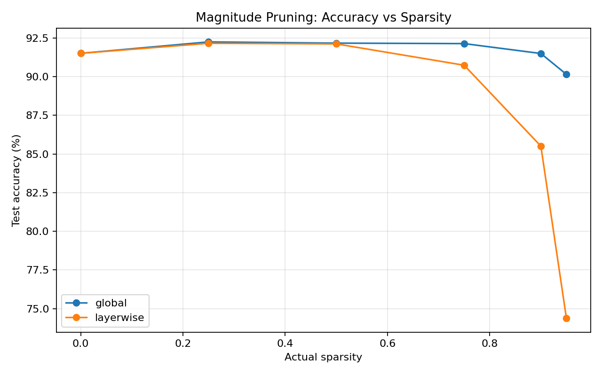
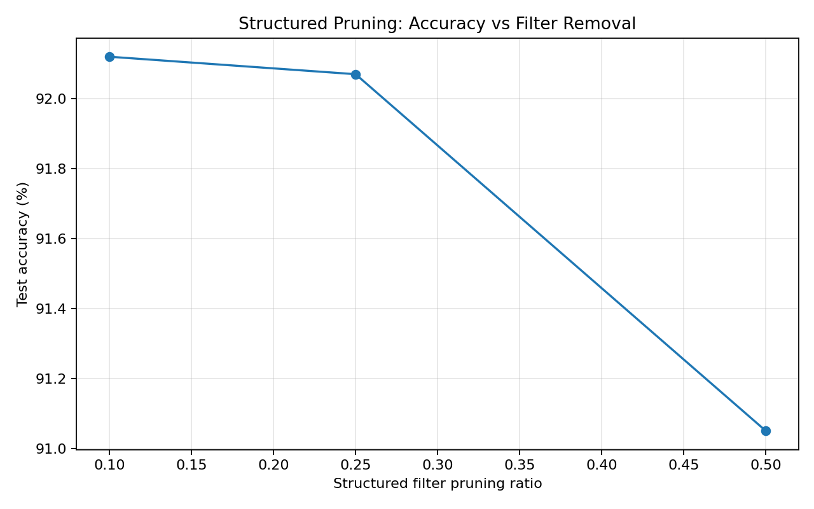
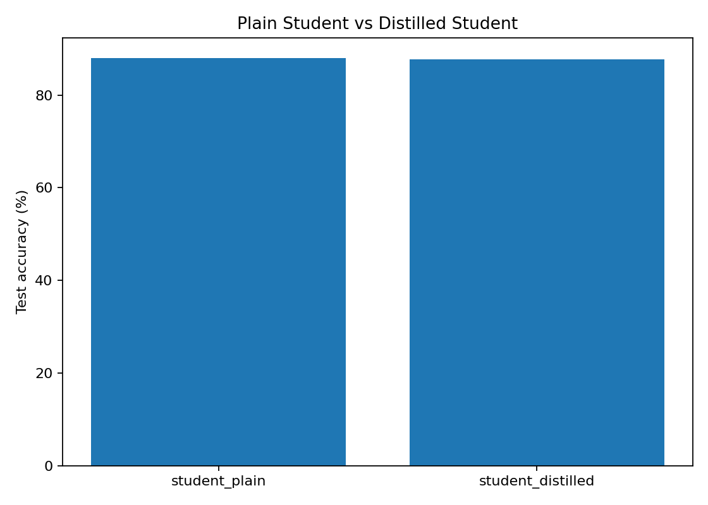

# Lab 7: Compression — Pruning and Distillation

**Student:** Kyrylo  
**Student ID:** 71608  
**Dataset:** Fashion-MNIST  
**Device:** cpu

## 1. Objective

This lab studies model compression using magnitude pruning, structured filter pruning, and knowledge distillation. The experiments use the complete Fashion-MNIST training split rather than a reduced subset. The main goal is to compare accuracy, parameter count, on-disk size, inference latency, compute, and an explicitly labelled energy proxy while keeping the analysis honest about the difference between storage sparsity and real hardware speedup.

The required sparsity targets are `0, 0.25, 0.5, 0.75, 0.9, 0.95`. Magnitude pruning is performed globally and layer-wise. Every non-zero pruning target is fine-tuned for exactly 3 epochs with the pruning mask fixed. Structured pruning physically removes convolutional filters according to L2 norm at `10%, 25%, 50%`. Distillation uses the oversized baseline as teacher, a student below 100k parameters, `T=4`, and `alpha=0.5`.

## 2. Experimental Setup

Fashion-MNIST contains 60,000 training images and 10,000 test images. A deterministic 55,000/5,000 split is used for training and validation, and the official 10,000-image test split is kept for final evaluation. Inputs are normalized with mean `0.2860` and standard deviation `0.3530`.

The oversized baseline CNN has four convolutional layers followed by two fully connected layers. Its recorded parameter count is **1,044,490**, which is close to the requested 1M-parameter scale.

| Setting | Value |
|---|---:|
| Seed | 42 |
| Baseline epochs | 5 |
| Pruning fine-tune epochs | 3 |
| Student epochs | 5 |
| Training batch size | 256 |
| Baseline learning rate | 0.001 |
| Pruning fine-tune learning rate | 0.0001 |
| Distillation temperature | 4.0 |
| Distillation alpha | 0.5 |

## 3. Task 1 — Oversized Baseline CNN

The oversized baseline was trained on the full Fashion-MNIST training data. The final test accuracy was **91.51%**. The model contains **1,044,490 parameters**, occupies **3.989 MB** as a dense PyTorch state dictionary, and has median batch-1 latency of **1.303 ms** on the recorded device.

The baseline compute is **58.833 million MACs per image**.

Generated evidence:

- `results/task1_baseline_history.csv`
- `results/task1_baseline_metrics.csv`
- `results/task1_baseline.pt`

## 4. Task 2 — Magnitude Pruning

For global pruning, all convolutional and linear weights are ranked together by absolute value and the smallest weights are masked. For layer-wise pruning, the same sparsity percentage is applied independently inside each convolutional and linear layer. The mask remains fixed during 3 fine-tuning epochs, so pruned connections cannot regrow.

| method    |   target_sparsity |   actual_sparsity |   test_accuracy |   dense_size_mb |   sparse_size_mb |   latency_ms |
|:----------|------------------:|------------------:|----------------:|----------------:|-----------------:|-------------:|
| global    |             0.000 |             0.000 |          91.510 |           3.989 |           23.581 |        1.206 |
| global    |             0.250 |             0.250 |          92.250 |           3.989 |           18.329 |        1.232 |
| global    |             0.500 |             0.500 |          92.170 |           3.989 |           12.831 |        1.233 |
| global    |             0.750 |             0.750 |          92.140 |           3.989 |            6.944 |        1.484 |
| global    |             0.900 |             0.900 |          91.500 |           3.989 |            3.034 |        1.221 |
| global    |             0.950 |             0.950 |          90.150 |           3.989 |            1.580 |        1.231 |
| layerwise |             0.000 |             0.000 |          91.510 |           3.989 |           23.581 |        1.247 |
| layerwise |             0.250 |             0.250 |          92.160 |           3.989 |           17.688 |        1.311 |
| layerwise |             0.500 |             0.500 |          92.120 |           3.989 |           11.794 |        1.294 |
| layerwise |             0.750 |             0.750 |          90.740 |           3.989 |            5.901 |        1.217 |
| layerwise |             0.900 |             0.900 |          85.510 |           3.989 |            2.365 |        1.223 |
| layerwise |             0.950 |             0.950 |          74.370 |           3.989 |            1.186 |        1.203 |

The best global-pruning point by test accuracy was target sparsity **0.25**, with **92.25%** accuracy. The best layer-wise point was target sparsity **0.25**, with **92.16%** accuracy.

The curve shows how aggressively weights can be removed before the accuracy penalty becomes significant. Moderate sparsity often preserves most of the baseline performance, while very high sparsity can cause a sharper degradation because too much representational capacity is removed.

## 5. Structured Filter Pruning

Structured pruning ranks whole convolutional filters by L2 norm and physically removes the lowest-ranked output channels. Dependent input channels in the following convolution and the corresponding fully connected input features are also removed. Unlike unstructured masking, this changes tensor shapes and therefore can reduce real dense-kernel compute.

|   prune_ratio |     params |   test_accuracy |   size_mb |   latency_ms |   macs_m |
|--------------:|-----------:|----------------:|----------:|-------------:|---------:|
|         0.100 | 917469.000 |          92.120 |     3.504 |        1.201 |   47.890 |
|         0.250 | 738794.000 |          92.070 |     2.822 |        0.838 |   33.287 |
|         0.500 | 463050.000 |          91.050 |     1.771 |        0.581 |   14.966 |

The best structured configuration by test accuracy used a pruning ratio of **0.10** and reached **92.12%** test accuracy.

## 6. Task 3 — Storage Size and Honest Latency Analysis

The experiment stores unstructured models in two ways: a normal dense PyTorch state dictionary and a custom sparse representation containing non-zero indices and values. This directly measures the difference between mathematical sparsity and actual file size.

The latency measurements deliberately use the normal dense PyTorch execution path. This is important because zero weights inside dense tensors do not automatically select sparse convolution kernels. Therefore, unstructured pruning can reduce the number of non-zero parameters and may reduce storage in an appropriate sparse format, while producing little or no latency improvement in ordinary dense CPU kernels.

`results/task3_latency_storage.csv` contains the complete comparison.

| method    |   target_sparsity |   actual_sparsity |   dense_size_mb |   sparse_size_mb |   latency_ms |   dense_macs_m |   ideal_nonzero_macs_m |
|:----------|------------------:|------------------:|----------------:|-----------------:|-------------:|---------------:|-----------------------:|
| global    |             0.000 |             0.000 |           3.989 |           23.581 |        1.206 |         58.833 |                 58.833 |
| global    |             0.250 |             0.250 |           3.989 |           18.329 |        1.232 |         58.833 |                 44.124 |
| global    |             0.500 |             0.500 |           3.989 |           12.831 |        1.233 |         58.833 |                 29.416 |
| global    |             0.750 |             0.750 |           3.989 |            6.944 |        1.484 |         58.833 |                 14.708 |
| global    |             0.900 |             0.900 |           3.989 |            3.034 |        1.221 |         58.833 |                  5.883 |
| global    |             0.950 |             0.950 |           3.989 |            1.580 |        1.231 |         58.833 |                  2.942 |
| layerwise |             0.000 |             0.000 |           3.989 |           23.581 |        1.247 |         58.833 |                 58.833 |
| layerwise |             0.250 |             0.250 |           3.989 |           17.688 |        1.311 |         58.833 |                 44.124 |
| layerwise |             0.500 |             0.500 |           3.989 |           11.794 |        1.294 |         58.833 |                 29.416 |
| layerwise |             0.750 |             0.750 |           3.989 |            5.901 |        1.217 |         58.833 |                 14.708 |
| layerwise |             0.900 |             0.900 |           3.989 |            2.365 |        1.223 |         58.833 |                  5.883 |
| layerwise |             0.950 |             0.950 |           3.989 |            1.186 |        1.203 |         58.833 |                  2.942 |

Structured pruning is different because channels are physically removed. That changes tensor dimensions, reduces dense MACs, and is much more likely to produce a measurable latency reduction on standard hardware.

## 7. Task 4 — Knowledge Distillation

The oversized baseline is used as the teacher. The compact student contains fewer than 100k parameters. Two students are trained under the same epoch budget: one with ordinary cross-entropy and one with knowledge distillation.

The distillation objective is:

`alpha * CE(student, labels) + (1-alpha) * T^2 * KL(softmax(student/T) || softmax(teacher/T))`

with `T=4` and `alpha=0.5`.

| model             |   params |   test_accuracy |   size_mb |   latency_ms |   macs_m |
|:------------------|---------:|----------------:|----------:|-------------:|---------:|
| student_plain     |    86246 |          87.980 |     0.333 |        0.392 |    1.982 |
| student_distilled |    86246 |          87.720 |     0.333 |        0.286 |    1.982 |

The plain student reached **87.98%**, while the distilled student reached **87.72%**. The distilled student therefore changed accuracy by **-0.26 percentage points** relative to the plain student under the same training budget.

The student model has **86,246 parameters**, satisfying the requirement of approximately 100k parameters or fewer.

## 8. Task 5 — Efficiency Pillars Summary

The final comparison is organized around the efficiency pillars from Chapter 9: data, model, compute, and energy.

| model                 | data                                | model_efficiency            |   accuracy |   params |   size_mb |   latency_ms |   macs_m |   energy_proxy_rel |
|:----------------------|:------------------------------------|:----------------------------|-----------:|---------:|----------:|-------------:|---------:|-------------------:|
| baseline_teacher      | full Fashion-MNIST                  | dense ~1M CNN               |     91.510 |  1044490 |     3.989 |        1.303 |   58.833 |              1.000 |
| best_global_s0.25     | full Fashion-MNIST                  | unstructured sparse         |     92.250 |  1044490 |    18.329 |        1.232 |   58.833 |              0.946 |
| best_structured_r0.10 | full Fashion-MNIST                  | physically smaller channels |     92.120 |   917469 |     3.504 |        1.201 |   47.890 |              0.750 |
| student_distilled     | full Fashion-MNIST + teacher logits | <100k student               |     87.720 |    86246 |     0.333 |        0.286 |    1.982 |              0.007 |

### Data

All models use the same full Fashion-MNIST dataset, normalization, deterministic split, and test set. This keeps the compression comparison controlled and prevents data quantity from becoming a hidden variable.

### Model

Unstructured magnitude pruning reduces the number of non-zero weights without changing layer shapes. Structured pruning physically reduces channels and parameter count. Distillation replaces the oversized teacher with a much smaller student.

### Compute

Dense MACs remain almost unchanged for unstructured pruning because the network shapes are unchanged. Structured pruning and the student model reduce dense MACs directly. This distinction explains why parameter sparsity alone is not equivalent to real inference acceleration.

### Energy

Direct joule measurement is not available from portable PyTorch APIs on this Windows/CPU setup. The report therefore uses an **energy proxy**, not a claimed physical energy measurement. The proxy is proportional to measured latency multiplied by dense MAC count and is normalized to the baseline. Lower values indicate a model that performs less dense work for less measured execution time. Actual energy should be measured with platform-specific power counters for deployment-grade conclusions.

## 9. Main Conclusions

1. Magnitude pruning can remove a large fraction of weights while preserving useful accuracy at moderate sparsity.
2. Unstructured sparsity is valuable for compression, but it does not automatically speed up dense CPU kernels because standard convolution and linear operators still process dense tensor shapes.
3. Structured filter pruning provides a more direct path to latency reduction because it physically reduces channel dimensions and dense compute.
4. Knowledge distillation produced a compact sub-100k-parameter student, but in this experiment it did not outperform plain supervised training: the distilled student reached 87.72% accuracy versus 87.98% for the plain student.
5. Compression must be evaluated across accuracy, size, latency, compute, and energy rather than by sparsity alone.

## 10. Graded Evidence

The required evidence is generated automatically:

- `results/task2_magnitude_pruning_accuracy.png` — sparsity curves for global and layer-wise pruning
- `results/task2_structured_pruning_accuracy.png` — structured pruning curve
- `results/task3_latency_storage.csv` — dense-vs-sparse storage and latency analysis
- `results/task4_distillation_comparison.csv` — distilled vs plain student
- `results/task4_distillation_comparison.png` — student comparison plot
- `results/task5_efficiency_summary.csv` — final efficiency table
- `report.md` — this report with the measured values from the completed run

## 11. Reproducibility

The experiment uses a fixed random seed and deterministic train/validation split. The script saves all main intermediate tables, curves, checkpoints, and the final report. All reported numerical values are produced by the current run rather than hard-coded into the report.
